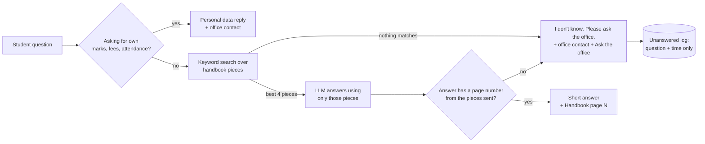

# Campus Doubt Desk

**A chatbot that answers student questions from the college handbook PDF and shows the page number with every answer.**

Students ask in their own words. The bot answers only from the handbook, cites the page, and says
"I don't know. Please ask the office." when the handbook does not have the answer. In that case it also
shows the office contact and an "Ask the office" button that opens an email with the question already written.

Built for the JuvenileAI x Scult Academy workshop (October 2026) from the product docs in [`docs/`](docs/).

---

## Contents

- [Why this exists](#why-this-exists)
- [Features](#features)
- [Tech stack](#tech-stack)
- [How it works](#how-it-works)
- [Project structure](#project-structure)
- [Getting started](#getting-started)
- [Using the app](#using-the-app)
- [Manual test checklist](#manual-test-checklist)
- [Automatic tests](#automatic-tests)
- [API reference](#api-reference)
- [Configuration](#configuration)
- [Privacy and safety rules](#privacy-and-safety-rules)
- [Roadmap status](#roadmap-status)
- [Updating the handbook](#updating-the-handbook)
- [Troubleshooting](#troubleshooting)
- [Limitations](#limitations)
- [Project docs](#project-docs)

---

## Why this exists

- The student handbook is long, and almost nobody reads it.
- Students ask seniors or WhatsApp groups instead, and often get wrong answers.
- The same simple questions (attendance, fees, exams, hostel) reach the college office every day.
- A wrong answer can make a student miss a fee deadline or an exam form date.

**Goal:** help students get the correct handbook answer in seconds, without going to the office.
Full problem statement, personas and success metrics are in [`docs/prd.md`](docs/prd.md).

## Features

| Feature | What the student sees |
| --- | --- |
| Handbook answers | A short answer (5 lines or less, simple English) taken only from the handbook |
| Page number | "📄 Handbook page 9" under every answer, so the student can check it |
| "I don't know" rule | "I don't know. Please ask the office." when the handbook has no answer |
| Office contact | Office email, extension, location and hours, read from the handbook's contacts page |
| Ask the office | A button that opens an email to the office with the question already filled in |
| Personal data guard | Questions like "What are my marks?" are told the bot can't see personal data |
| Suggested questions | 5 starter questions to tap |
| Feedback | 👍 "Yes, this helped" / 👎 "No" under every answer, counted for the success metrics |
| Disclaimer | "For official decisions, contact the college office." under every answer |
| Office list | A page for office staff and the PM with every unanswered question and usage counts |
| Phone friendly | Works on a 360 px wide phone screen with no side-scrolling |

## Tech stack

| Part | Choice |
| --- | --- |
| Backend | Python, [FastAPI](https://fastapi.tiangolo.com/), Uvicorn |
| Frontend | One plain HTML page with vanilla JavaScript (no framework) |
| PDF reading | [pypdf](https://pypi.org/project/pypdf/) |
| Search | Simple BM25 keyword search written in plain Python (no vector database) |
| LLM | [Groq](https://groq.com/) API, model `openai/gpt-oss-120b`, called with `httpx` |
| Storage | Small JSON files in `data/` (no database) |

The stack follows the rules in [`docs/agent.md`](docs/agent.md): Python, FastAPI and a simple HTML page, with no big extra libraries.

## How it works



1. **Read the handbook.** On start-up, `app/handbook.py` reads `data/handbook.pdf` page by page.
   Lines that repeat on most pages (headers like "Page 9 of 25") are removed. The text is checked so a scanned or empty PDF is reported.
2. **Split into pieces.** `app/search.py` cuts each page into pieces of about 700 characters.
   Every piece keeps its page number and section title.
3. **Find the right pieces.** For each question, a BM25 keyword search picks the best 4 pieces.
   A small synonym list helps with different wording, for example "deadline" also searches "last date" and "due".
4. **Ask the LLM.** `app/answer.py` sends only those 4 pieces to the LLM. It must reply in JSON with a status
   (`answer`, `unknown` or `personal`), the answer text and the page number.
5. **Check the answer.** If the page number is missing, or is not one of the pages that were sent,
   the bot does not give the answer. It says "I don't know. Please ask the office." instead.
6. **Log what was missed.** Unanswered questions are saved with the date and time only.

Sending only a few small pieces keeps each request small. That keeps answers fast and stays inside the Groq rate limit.

## Project structure

```text
.
├── main.py               # FastAPI backend: routes, start-up, office list page
├── app/
│   ├── handbook.py       # Reads the PDF, removes repeated headers, checks the text is readable
│   ├── search.py         # Splits pages into pieces and runs the BM25 keyword search
│   ├── llm.py            # Calls the Groq API and returns its JSON reply (retries on rate limits)
│   ├── answer.py         # The answer rules: personal data, page number check, "I don't know"
│   ├── contacts.py       # Reads the office email, extension and hours from the contacts page
│   └── store.py          # Saves unanswered questions and usage counts (no personal data)
├── static/
│   └── index.html        # The chat page (frontend)
├── data/
│   └── handbook.pdf      # The handbook the bot answers from
├── tests/
│   ├── questions.json    # 20 handbook questions, 5 out-of-handbook questions, 1 personal question
│   └── run_tests.py      # Runs the roadmap "Done when" checks
├── docs/                 # PRD, roadmap, growth plan, agent rules, handover note
├── start_all.bat         # Windows: starts backend and frontend and opens the browser
├── start_backend.bat     # Windows: starts the backend on port 8000
├── start_frontend.bat    # Windows: serves the chat page on port 5500
├── requirements.txt
└── .env.example          # Copy to .env and add your Groq API key
```

## Getting started

### 1. Requirements

- Python 3.10 or newer
- A Groq API key. Create one at [console.groq.com](https://console.groq.com/keys).

### 2. Install

```bash
git clone https://github.com/Pranjulrathour/CAMPUS-DESK-CHATBOT-JUVNILE-AI-2026.git
cd CAMPUS-DESK-CHATBOT-JUVNILE-AI-2026
pip install -r requirements.txt
```

### 3. Add your API key

```bash
cp .env.example .env
```

Open `.env` and put your key after `GROQ_API_KEY=`. The `.env` file is in `.gitignore`, so it is never committed.

### 4. Run it

**Windows:** double-click `start_all.bat`. It opens a backend window and a frontend window, then opens the chat in your browser.
You can also run `start_backend.bat` and `start_frontend.bat` yourself.

**macOS or Linux:** run each server in its own terminal.

```bash
python -m uvicorn main:app --host 127.0.0.1 --port 8000 --reload
```

```bash
python -m http.server 5500 --bind 127.0.0.1 --directory static
```

| What | URL |
| --- | --- |
| Chat page (frontend) | http://localhost:5500 |
| Backend API | http://localhost:8000 |
| Interactive API docs (try every endpoint) | http://localhost:8000/docs |
| Unanswered questions list for office staff | http://localhost:8000/unanswered |
| Health check | http://localhost:8000/api/health |

The backend also serves the same chat page at http://localhost:8000, so one server is enough for a quick demo.
Press Ctrl+C in a server's window to stop it.

## Using the app

**Students** open the chat page, tap a suggested question or type their own, and press Send.
"Thinking..." shows while the answer loads.

**Office staff and the PM** open http://localhost:8000/unanswered once a week. It shows:

- every question the bot could not answer, newest first, with the date and time
- questions asked, "I don't know" count and rate, thumbs up and down, thumbs-up rate, and average answer time

These numbers match the metrics in [`docs/growth.md`](docs/growth.md).

## Manual test checklist

1. **Normal question:** tap "What is the minimum attendance?". You should see 75%, "Handbook page 9" and the disclaimer line.
2. **Thinking message:** while you wait, the chat shows "Thinking...".
3. **Not in the handbook:** ask "What is the canteen menu today?". You should see "I don't know. Please ask the office.", the office contact and an "Ask the office" button.
4. **Ask the office:** tap the button. Your email app should open with the question already typed in.
5. **Personal data:** ask "What are my marks?". The bot should say it can't see personal data and point you to the office.
6. **Feedback:** tap "Yes, this helped". It should say "Thanks for your feedback!".
7. **Office list:** open http://localhost:8000/unanswered. The canteen question should be listed with its date and time.
8. **Phone screen:** press F12, turn on the device toolbar and pick a 360 px wide phone. Nothing should scroll sideways.

## Automatic tests

```bash
python tests/run_tests.py
```

The script runs the "Done when" checks from [`docs/roadmap.md`](docs/roadmap.md).
It takes about 4 minutes because calls are spaced out to stay under the Groq rate limit.
Test logs go to a temporary folder, so they never mix with the real `data/` logs.

| Check | Target | Last full run |
| --- | --- | --- |
| Answers with a page number | 20 of 20 | 20 of 20 |
| Correct answers (right page and key fact) | at least 18 of 20 | 19 of 20 (see note) |
| Answers under 10 seconds | at least 19 of 20 | 20 of 20 (1.2 to 2.8 s) |
| "What is the canteen menu today?" says "I don't know" | yes | yes |
| Out-of-handbook questions show contact and Ask the office link | 5 of 5 | 5 of 5 |
| Unanswered list has those 5 with date and time, nothing else | yes | yes |
| "What are my marks?" points to the office | yes | yes |

**Note:** the one failure was in the checker, not the bot. The answer said "14 August 2026" with a special
no-break space, which the checker did not match. The checker now normalizes spaces, and that question passes.

Office staff must still check the 20 answers by hand before launch. That is a Phase 4 step in the roadmap.

## API reference

| Method | Path | Body | Returns |
| --- | --- | --- | --- |
| `GET` | `/` | | The chat page |
| `GET` | `/api/suggested` | | List of suggested questions |
| `POST` | `/api/ask` | `{"question": "..."}` | The answer (see below) |
| `POST` | `/api/feedback` | `{"vote": "up"}` or `{"vote": "down"}` | `{"ok": true}` |
| `GET` | `/api/unanswered` | | Unanswered questions, newest first |
| `GET` | `/unanswered` | | Office list page with usage counts |
| `GET` | `/api/health` | | Pages read, text problems, office contact found |

Example answer from `POST /api/ask`:

```json
{
  "type": "answer",
  "answer": "You need at least 75% attendance in each course to sit the end-semester exam.",
  "page": 9,
  "disclaimer": "For official decisions, contact the college office.",
  "seconds": 1.9,
  "rate_limit_wait": 0
}
```

`type` is one of `answer`, `unknown`, `personal` or `error`. For anything except `answer`, the reply also has
`contact` (office, email, phone, location, hours, page) and `ask_office_link` (a `mailto:` link with the question filled in).

## Configuration

Settings live in `.env`:

| Name | What it is | Default |
| --- | --- | --- |
| `GROQ_API_KEY` | Your Groq API key (required) | none |
| `GROQ_MODEL` | The Groq model to use | `openai/gpt-oss-120b` |

## Privacy and safety rules

- **Handbook only.** The LLM is told to use only the handbook pieces it is given, never outside knowledge.
- **No page, no answer.** An answer is shown only if it comes with a page number from the pieces that were sent.
- **No personal data.** There is no login. The bot never asks for or stores a name, roll number, marks or fee status.
- **Minimal logs.** Unanswered questions are saved with the date and time only. Emails and long numbers, such as roll numbers, are replaced with `[removed]` before saving.
- **Keys stay local.** The API key is read from `.env`, which is never committed.
- **Not the final word.** Every answer says "For official decisions, contact the college office."

Out of scope by design (see the PRD non-goals): login, personal records, admission questions for new applicants, general chat, and actions like paying fees.

## Roadmap status

| Phase | What | Status |
| --- | --- | --- |
| 1 | Ask one question, get one answer from the handbook | Done |
| 2 | Page numbers, "I don't know", personal data rule, 20 test questions | Done |
| 3 | Chat screen, disclaimer, "Thinking...", phone layout, speed check | Done |
| 4 | Suggested questions, thumbs up/down, saved counts | Done in code. Office staff review and 5-student trial still to do |
| 5 | Office contact, Ask the office button, unanswered log and list | Done |

The "Later" items from the PRD (Hindi or Hinglish, a WhatsApp version, easier handbook updates) are not built yet.

## Updating the handbook

1. Replace `data/handbook.pdf` with the new PDF.
2. Restart the backend. Look at http://localhost:8000/api/health to confirm the page count and that `problems` is empty.
3. Update the expected answers and pages in `tests/questions.json`, then run `python tests/run_tests.py`.

The office contact is read from the page titled "Contacts" (or a page that mentions "Important Contacts" or "Office hours").

## Troubleshooting

| Problem | Fix |
| --- | --- |
| `GROQ_API_KEY is missing` | Create `.env` from `.env.example` and add your key. Restart the backend. |
| Every answer is "Sorry, I can't answer right now" | Check the backend window for the error. The key may be wrong, or the model may not be available on your Groq account. Change `GROQ_MODEL` in `.env`. |
| `model_not_found` from Groq | Groq retires models over time. Pick a current one from your Groq console and set it in `GROQ_MODEL`. |
| Slow answers during a busy demo | Groq free keys have a tokens-per-minute limit. The app waits and retries, but many users at once will queue. |
| Chat page on port 5500 shows nothing or errors | Make sure the backend is running on port 8000. |
| `Address already in use` | Another program is using port 8000 or 5500. Close it, or change the port in the start scripts. |

## Limitations

- The search is keyword based. A question with very different words from the handbook may get "I don't know".
- Text is read from the PDF's text layer. A scanned handbook without text will not work (the health check reports it).
- The office list has no login, because login is a non-goal in the PRD. Anyone who can reach the server can open it.
- The included `data/handbook.pdf` is sample data for the workshop. The institute in it is fictional.

## Project docs

| File | What it covers |
| --- | --- |
| [`docs/prd.md`](docs/prd.md) | Problem, users, goals, requirements, non-goals, acceptance criteria |
| [`docs/roadmap.md`](docs/roadmap.md) | The 5 build phases and their "Done when" checks |
| [`docs/growth.md`](docs/growth.md) | Success metrics, experiments and launch plan |
| [`docs/agent.md`](docs/agent.md) | Build rules: tech stack, answer rules, what not to build |
| [`docs/handover.md`](docs/handover.md) | Handover note from the PM |

Product docs by Saksham (PM). Built by Pranjul Rathour.
